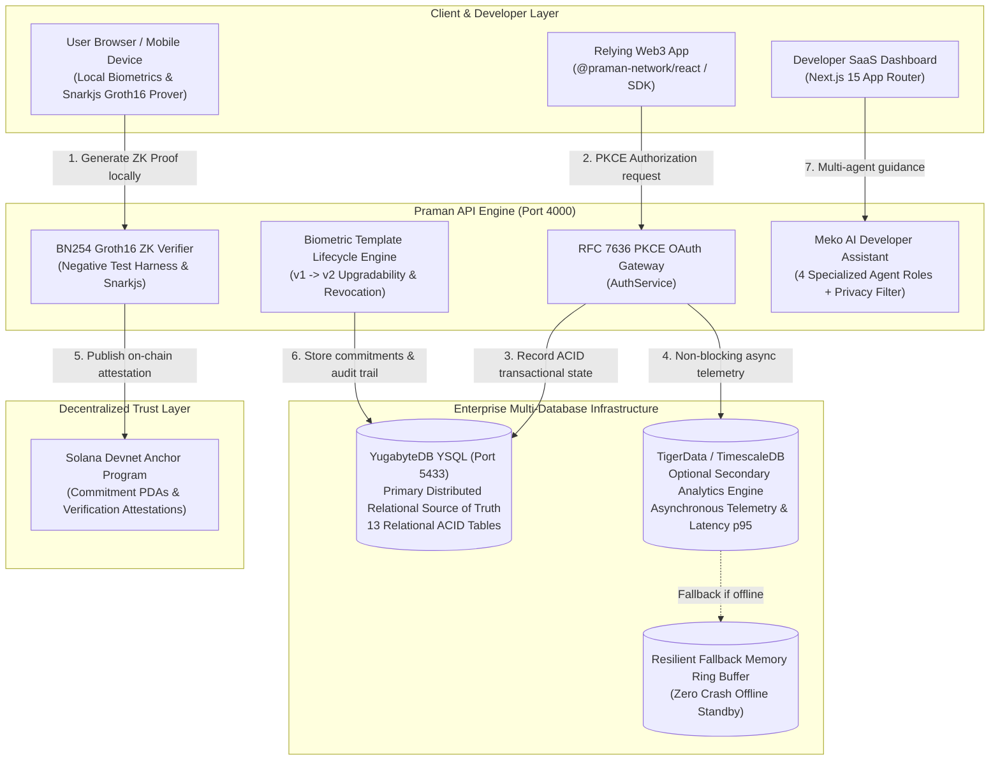

# Praman Network: Architecture Overview

## 1. High-Level System Architecture

Praman Network is a privacy-preserving identity and authentication infrastructure designed for decentralized applications, web3 portals, and enterprise security workflows. It ensures that users can authenticate using zero-knowledge biometrics without ever exposing facial photographs, embeddings, or personally identifiable information (PII) to relying applications or centralized databases.

---

## 2. Core Architectural Components

### A. Primary Transactional Database: YugabyteDB (YSQL)
- **Role:** Distributed source of truth for all transactional state.
- **Port:** `5433` (PostgreSQL wire compatible).
- **Entities Managed:** Developers, projects, API keys, whitelisted domains, callback URLs, registered users, identity commitments, biometric template versions ($v1, v2 \dots$), encrypted vault references, verification sessions, and subscriptions.
- **Resilience:** Implements exponential backoff with jitter in `YugabyteService.queryWithRetry` to handle tablet splits, rebalancing, and distributed SQL transients (e.g. error codes `40001`, `57P01`, `08006`).

### B. Secondary Analytics Database: TigerData (TimescaleDB)
- **Role:** Optional, asynchronous time-series telemetry and request volume analytics.
- **Non-Blocking Invariant:** Asynchronous event ingestion (`TigerDataService.recordEventAsync`) fires via `setImmediate` and never blocks authentication latency or causes user-facing errors.
- **Graceful Standby:** In the event that TigerData credentials are omitted or the database instance is unreachable, telemetry seamlessly streams to an in-memory ring buffer of 5,000 entries.

### C. Developer Intelligence: Meko AI Multi-Agent Layer
- **Role:** Contextual developer assistance embedded within the Developer Dashboard (`apps/web/src/app/dashboard/page.tsx`).
- **Specialized Roles:**
  1. `INTEGRATION_AGENT`: Step-by-step React and Next.js SDK setup.
  2. `TROUBLESHOOTING_AGENT`: Root cause analysis for `DOMAIN_NOT_WHITELISTED`, `NONCE_MISMATCH`, and `401 Unauthorized`.
  3. `SECURITY_AGENT`: Zero-knowledge proof validation, DNS TXT domain verification, and replay resistance.
  4. `ANALYTICS_ASSISTANT`: Interpreting request volume, p95 verification latency, and Solana Devnet block confirmations.
- **Zero-Raw Privacy Sandbox:** Before any prompt is dispatched to an AI model, `MekoService.sanitizeContext` scrubs API keys, webhook secrets, RSA/ECC private keys, and cryptographic hashes. Biometric embeddings and ZK witness inputs are never handled by the AI layer.

### D. Zero-Knowledge Circuit (`BiometricMatch.circom`)
- **Proving Scheme:** BN254 / BN128 Groth16 zero-knowledge proofs.
- **Inputs:**
  - Private Inputs: User biometric embedding vector (128/512 dims), user secret salt.
  - Public Signals: Poseidon commitment hash, threshold distance, fresh session nonce, audience client ID, expiration epoch.
- **Privacy Guarantee:** The relying party and server learn only whether the facial biometric satisfies the similarity threshold; the vector itself is never revealed.

### E. Decentralized Attestation: Solana Devnet
- **Program ID:** `AgWrVQjE96uKhyqK4QJsR3HnkTwbC1fvKFdjuTQNKGCP`
- **Program Derived Addresses (PDAs):**
  - `IdentityRegistry`: Anchors the active Poseidon commitment on-chain.
  - `AttestationRecord`: Records proof hashes, nonces, and timestamp for public auditability without revealing identity.

