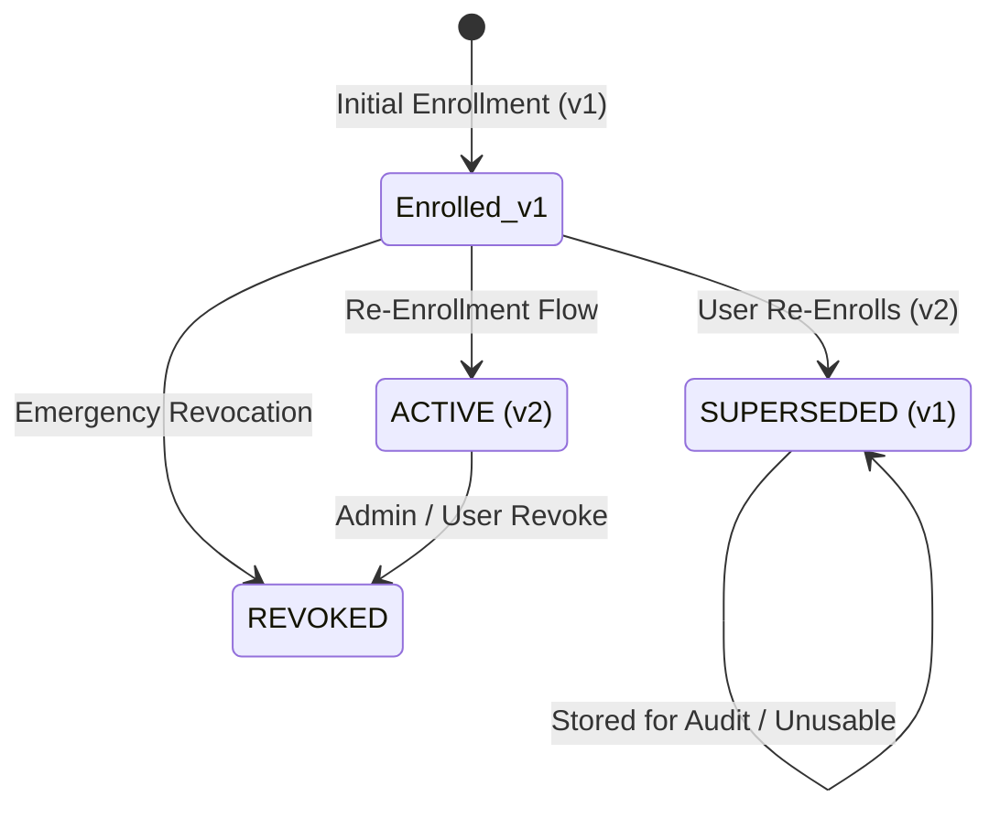

# Praman Network: Biometric Template Lifecycle & Upgradability

## 1. Overview & Problem Statement

Human facial biometric features undergo natural physiological drift over time (aging, injury, facial hair, surgery). Furthermore, machine learning models continuously improve (e.g. migrating from `facenet-512` to newer zero-leakage neural embeddings). 

A production identity infrastructure must support **template versioning and secure re-enrollment** without invalidating past identity history or leaking biometric templates.

---

## 2. Template Lifecycle State Machine



### State Definitions:
1. **`ACTIVE`:** The single authorized template version used to verify zero-knowledge biometric proofs during authentication challenges.
2. **`SUPERSEDED`:** A historical template version that has been replaced by a newer version ($v+1$). Retained for dispute resolution and historical auditability; **strictly disallowed from authenticating**.
3. **`REVOKED`:** A template version explicitly disabled due to suspected device compromise, user request, or security policy.

---

## 3. Strict Zero-Raw Biometric Invariant

Under no circumstances does Praman Network store raw photographs, video streams, or raw facial embedding coordinates in YugabyteDB or file storage.

Each template record contains:
- `templateVersion`: Monotonically increasing integer ($1, 2, 3 \dots$).
- `modelVersion`: Model identifier (e.g. `facenet-512`).
- `commitment`: Cryptographic Poseidon BN254 hash computed inside local device RAM.
- `saltHex`: Cryptographic blinding factor.
- `encryptedTemplateReference`: AES-256-GCM envelope vault reference encrypted with the user's master key.
- `solanaAttestationTx`: Transaction signature confirming commitment anchoring to Solana Devnet.

---

## 4. API Endpoints

### 1. Retrieve User Template Versions
```http
GET /api/v1/identity/:userId/templates
```
Returns all template versions sorted in reverse chronological order:
```json
[
  {
    "id": "tmpl_350291ba68194a2b",
    "pramanUserId": "usr_alice_demo_01",
    "templateVersion": 2,
    "modelVersion": "facenet-512",
    "commitment": "0x29bb890e1bcba3d57803a0e59ca65378291aebf102839213847291aebf102839",
    "status": "ACTIVE",
    "enrolledAt": "2026-10-31T19:35:12.000Z",
    "solanaAttestationTx": "5Jz9rW..."
  },
  {
    "id": "tmpl_910481fa88204b1c",
    "pramanUserId": "usr_alice_demo_01",
    "templateVersion": 1,
    "modelVersion": "facenet-512",
    "commitment": "0x17fa890e1bcba3d57803a0e59ca65378291aebf102839213847291aebf102839",
    "status": "SUPERSEDED",
    "enrolledAt": "2026-10-25T12:00:00.000Z",
    "supersededAt": "2026-10-31T19:35:12.000Z"
  }
]
```

### 2. Biometric Re-Enrollment ($v+1$)
```http
POST /api/v1/identity/:userId/re-enroll
Content-Type: application/json

{
  "newCommitmentHash": "0x29bb890e1bcba3d57803a0e59ca65378291aebf102839213847291aebf102839",
  "newSaltHex": "c1b2c3d4e5f60718293a4b5c6d7e8f90",
  "reason": "Routine biometric model refresh",
  "modelVersion": "facenet-512"
}
```
**Execution Steps:**
1. Atomically marks the previous active template as `SUPERSEDED` and records `supersededAt`.
2. Anchors the new Poseidon commitment to the Solana Devnet `IdentityRegistry` program.
3. Inserts the new template record with `templateVersion = v + 1` and `status = ACTIVE`.
4. Writes an immutable audit entry to `audit_logs`.

### 3. Revoke Template Version
```http
POST /api/v1/identity/:userId/templates/:templateId/revoke
```
Transitions the target template's status to `REVOKED`. If the active template is revoked, authentication for that user is blocked until re-enrollment is executed.

