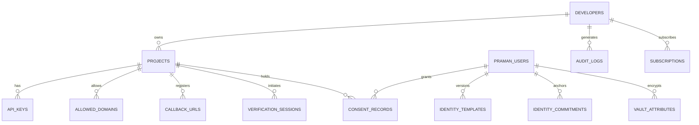

# Praman Network: YugabyteDB Relational Schema Documentation

Praman Network uses **YugabyteDB (YSQL interface, Port 5433)** as its primary distributed transactional database. All tables are structured using PostgreSQL wire-compatible SQL with foreign key constraints, cascade rules, and optimized indexes.

---

## 1. Relational Table Specifications

### 1. `developers`
Primary developer accounts accessing the Praman SaaS Dashboard.
| Column | Type | Constraints | Description |
| :--- | :--- | :--- | :--- |
| `id` | `VARCHAR(64)` | `PRIMARY KEY` | Unique developer identifier (`dev_...`) |
| `email` | `VARCHAR(255)` | `UNIQUE NOT NULL` | Verified developer email address |
| `name` | `VARCHAR(255)` | `NOT NULL` | Developer name or organization contact |
| `authentication_provider` | `VARCHAR(64)` | `DEFAULT 'email'` | Auth provider (`email`, `github`, `google`) |
| `password_hash` | `VARCHAR(255)` | `NOT NULL` | Argon2id / bcrypt salted hash |
| `avatar_url` | `TEXT` | `NULLABLE` | Profile avatar URI |
| `created_at` | `TIMESTAMPTZ` | `DEFAULT NOW()` | Record creation timestamp |
| `updated_at` | `TIMESTAMPTZ` | `DEFAULT NOW()` | Record modification timestamp |

### 2. `projects`
Applications registered by developers to integrate Praman authentication.
| Column | Type | Constraints | Description |
| :--- | :--- | :--- | :--- |
| `id` | `VARCHAR(64)` | `PRIMARY KEY` | Project identifier (`proj_...`) |
| `developer_id` | `VARCHAR(64)` | `REFERENCES developers(id) ON DELETE CASCADE` | Owning developer |
| `name` | `VARCHAR(255)` | `NOT NULL` | Public display name of application |
| `description` | `TEXT` | `NULLABLE` | Application description |
| `website_url` | `TEXT` | `NULLABLE` | Primary production domain |
| `client_id` | `VARCHAR(128)` | `UNIQUE NOT NULL` | Public OAuth2 client ID (`prm_client_...`) |
| `client_secret_hash` | `VARCHAR(255)` | `NOT NULL` | SHA-256 hash of API secret |
| `status` | `VARCHAR(32)` | `DEFAULT 'ACTIVE'` | `ACTIVE`, `SUSPENDED`, `ARCHIVED` |
| `environment` | `VARCHAR(32)` | `DEFAULT 'DEVELOPMENT'` | `DEVELOPMENT`, `STAGING`, `PRODUCTION` |
| `webhook_url` | `TEXT` | `NULLABLE` | Webhook notification endpoint |
| `webhook_secret` | `VARCHAR(255)` | `NULLABLE` | HMAC signing secret for webhooks |
| `created_at` | `TIMESTAMPTZ` | `DEFAULT NOW()` | Creation timestamp |
| `updated_at` | `TIMESTAMPTZ` | `DEFAULT NOW()` | Modification timestamp |

### 3. `api_keys`
API credentials for backend server-to-server operations.
| Column | Type | Constraints | Description |
| :--- | :--- | :--- | :--- |
| `id` | `VARCHAR(64)` | `PRIMARY KEY` | API key record identifier (`key_...`) |
| `project_id` | `VARCHAR(64)` | `REFERENCES projects(id) ON DELETE CASCADE` | Associated project |
| `name` | `VARCHAR(255)` | `NOT NULL` | Friendly key label |
| `key_prefix` | `VARCHAR(32)` | `NOT NULL` | First 12 characters (`prm_live_...`) |
| `key_hash` | `VARCHAR(255)` | `UNIQUE NOT NULL` | SHA-256 hash of raw API key |
| `environment` | `VARCHAR(32)` | `DEFAULT 'DEVELOPMENT'` | `DEVELOPMENT` or `PRODUCTION` |
| `scopes` | `VARCHAR(255)` | `DEFAULT 'read,write'` | Comma-delimited permissions |
| `last_used_at` | `TIMESTAMPTZ` | `NULLABLE` | Timestamp of last API invocation |
| `expires_at` | `TIMESTAMPTZ` | `NULLABLE` | Optional key expiration |
| `created_at` | `TIMESTAMPTZ` | `DEFAULT NOW()` | Generation timestamp |

### 4. `allowed_domains`
Origin domain whitelist for CORS and PKCE initiation protection.
| Column | Type | Constraints | Description |
| :--- | :--- | :--- | :--- |
| `id` | `VARCHAR(64)` | `PRIMARY KEY` | Domain record ID |
| `project_id` | `VARCHAR(64)` | `REFERENCES projects(id) ON DELETE CASCADE` | Target project |
| `domain` | `VARCHAR(255)` | `NOT NULL` | FQDN (e.g. `auth.example.com`, `localhost`) |
| `verification_token`| `VARCHAR(128)`| `NOT NULL` | DNS TXT verification token (`praman-verify=...`) |
| `status` | `VARCHAR(32)` | `DEFAULT 'PENDING'` | `PENDING`, `VERIFIED`, `REVOKED` |
| `verification_method`| `VARCHAR(32)`| `DEFAULT 'DNS_TXT'` | Method used (`DNS_TXT`, `HTTP_FILE`) |
| `verified_at` | `TIMESTAMPTZ` | `NULLABLE` | Timestamp of verification check |
| `created_at` | `TIMESTAMPTZ` | `DEFAULT NOW()` | Addition timestamp |

### 5. `callback_urls`
Registered OAuth2 redirect URIs preventing open redirect exploits.
| Column | Type | Constraints | Description |
| :--- | :--- | :--- | :--- |
| `id` | `VARCHAR(64)` | `PRIMARY KEY` | URL record ID |
| `project_id` | `VARCHAR(64)` | `REFERENCES projects(id) ON DELETE CASCADE` | Target project |
| `url` | `TEXT` | `NOT NULL` | Exact redirect URL |
| `created_at` | `TIMESTAMPTZ` | `DEFAULT NOW()` | Addition timestamp |

### 6. `praman_users`
End-user identity master records.
| Column | Type | Constraints | Description |
| :--- | :--- | :--- | :--- |
| `id` | `VARCHAR(64)` | `PRIMARY KEY` | Praman User ID (`usr_...`) |
| `phone_hash` | `VARCHAR(128)`| `UNIQUE NOT NULL` | SHA-256 hash of normalized phone |
| `phone_masked` | `VARCHAR(32)` | `NOT NULL` | Display string (e.g. `+1 ••• ••• 4912`) |
| `full_name` | `VARCHAR(255)`| `NOT NULL` | Encrypted or pseudonymized legal name |
| `status` | `VARCHAR(32)` | `DEFAULT 'ACTIVE'` | `ACTIVE`, `LOCKED`, `DELETED` |
| `internal_root_id`| `VARCHAR(128)`| `UNIQUE NOT NULL` | Internal root entropy for pairwise ID derivation |
| `created_at` | `TIMESTAMPTZ` | `DEFAULT NOW()` | Registration timestamp |
| `updated_at` | `TIMESTAMPTZ` | `DEFAULT NOW()` | Update timestamp |

### 7. `identity_templates`
Biometric template versioning, upgradability, and lifecycle management.
> **ZERO-RAW INVARIANT:** Neither raw face images nor unblinded floating-point embeddings are stored in this or any database table.
| Column | Type | Constraints | Description |
| :--- | :--- | :--- | :--- |
| `id` | `VARCHAR(64)` | `PRIMARY KEY` | Template record ID (`tmpl_...`) |
| `praman_user_id`| `VARCHAR(64)` | `REFERENCES praman_users(id) ON DELETE CASCADE` | User owning template |
| `template_version`| `INT` | `DEFAULT 1` | Incremental version ($v1, v2, v3 \dots$) |
| `model_version` | `VARCHAR(64)` | `DEFAULT 'facenet-512'` | ML embedding model identifier |
| `encrypted_template_reference`| `TEXT` | `NOT NULL` | AES-256-GCM envelope vault pointer |
| `commitment` | `VARCHAR(255)`| `NOT NULL` | Poseidon BN254 commitment hash |
| `salt_hex` | `VARCHAR(255)`| `NOT NULL` | Salt used in Poseidon tree |
| `status` | `VARCHAR(32)` | `DEFAULT 'ACTIVE'` | `ACTIVE`, `SUPERSEDED`, `REVOKED` |
| `enrolled_at` | `TIMESTAMPTZ` | `DEFAULT NOW()` | Enrollment timestamp |
| `superseded_at` | `TIMESTAMPTZ` | `NULLABLE` | Timestamp when replaced or revoked |
| `created_at` | `TIMESTAMPTZ` | `DEFAULT NOW()` | Record timestamp |

### 8. `identity_commitments`
On-chain Solana Devnet identity anchors.
| Column | Type | Constraints | Description |
| :--- | :--- | :--- | :--- |
| `id` | `VARCHAR(64)` | `PRIMARY KEY` | Commitment ID (`cmt_...`) |
| `praman_user_id`| `VARCHAR(64)` | `REFERENCES praman_users(id) ON DELETE CASCADE` | Target user |
| `commitment` | `VARCHAR(255)`| `UNIQUE NOT NULL` | Active Poseidon hash |
| `network` | `VARCHAR(64)` | `DEFAULT 'solana-devnet'` | Blockchain network |
| `transaction_signature`| `VARCHAR(128)`| `NULLABLE` | Solana transaction hash |
| `circuit_version`| `VARCHAR(64)` | `DEFAULT 'Groth16_BN254_v1'` | Proving circuit identifier |
| `created_at` | `TIMESTAMPTZ` | `DEFAULT NOW()` | Transaction timestamp |

### 9. `consent_records`
Fine-grained user authorization granted to specific applications.
| Column | Type | Constraints | Description |
| :--- | :--- | :--- | :--- |
| `id` | `VARCHAR(64)` | `PRIMARY KEY` | Consent record ID (`csnt_...`) |
| `praman_user_id`| `VARCHAR(64)` | `REFERENCES praman_users(id) ON DELETE CASCADE` | Granting user |
| `project_id` | `VARCHAR(64)` | `REFERENCES projects(id) ON DELETE CASCADE` | Authorized project |
| `pairwise_id` | `VARCHAR(128)`| `NOT NULL` | Application-specific isolated pseudonym |
| `requested_attributes`| `TEXT` | `NOT NULL` | JSON string of requested scopes |
| `approved_attributes`| `TEXT` | `NOT NULL` | JSON string of user-approved attributes |
| `consent_status`| `VARCHAR(32)` | `DEFAULT 'ACTIVE'` | `ACTIVE` or `REVOKED` |
| `consent_version`| `INT` | `DEFAULT 1` | Consent agreement version |
| `created_at` | `TIMESTAMPTZ` | `DEFAULT NOW()` | Grant timestamp |
| `revoked_at` | `TIMESTAMPTZ` | `NULLABLE` | Revocation timestamp |

### 10. `verification_sessions`
OAuth2 PKCE authorization challenge tracking.
| Column | Type | Constraints | Description |
| :--- | :--- | :--- | :--- |
| `id` | `VARCHAR(64)` | `PRIMARY KEY` | Session ID (`auth_req_...`) |
| `project_id` | `VARCHAR(64)` | `REFERENCES projects(id) ON DELETE CASCADE` | Requesting project |
| `praman_user_id`| `VARCHAR(64)` | `NULLABLE` | Authenticating user |
| `nonce_hash` | `VARCHAR(128)`| `NOT NULL` | SHA-256 hash of single-use challenge nonce |
| `audience` | `VARCHAR(128)`| `NOT NULL` | Bound client ID |
| `session_status`| `VARCHAR(32)` | `DEFAULT 'INITIATED'` | `INITIATED`, `VERIFIED`, `EXCHANGED`, `EXPIRED`, `REJECTED` |
| `auth_code` | `VARCHAR(128)`| `UNIQUE NULLABLE` | Short-lived authorization code (60 sec) |
| `redirect_uri` | `TEXT` | `NOT NULL` | Exact verified callback |
| `code_challenge`| `VARCHAR(128)`| `NOT NULL` | RFC 7636 PKCE S256 challenge |
| `pairwise_id` | `VARCHAR(128)`| `NULLABLE` | Derived pseudonym |
| `expires_at` | `TIMESTAMPTZ` | `NOT NULL` | Challenge expiration (10 min) |
| `created_at` | `TIMESTAMPTZ` | `DEFAULT NOW()` | Challenge initiation timestamp |

### 11. `verification_events`
Audit trail of zero-knowledge biometric verification executions.
| Column | Type | Constraints | Description |
| :--- | :--- | :--- | :--- |
| `id` | `VARCHAR(64)` | `PRIMARY KEY` | Event ID |
| `project_id` | `VARCHAR(64)` | `REFERENCES projects(id) ON DELETE CASCADE` | Context project |
| `praman_user_id`| `VARCHAR(64)` | `NULLABLE` | Target user |
| `verification_status`| `VARCHAR(32)` | `NOT NULL` | `SUCCESS` or `FAILED` |
| `verification_method`| `VARCHAR(64)` | `DEFAULT 'ZK_GROTH16'`| Verification mechanism |
| `circuit_version`| `VARCHAR(64)` | `DEFAULT 'Groth16_BN254_v1'`| Circom circuit version |
| `latency_ms` | `INT` | `DEFAULT 0` | Verification duration in ms |
| `created_at` | `TIMESTAMPTZ` | `DEFAULT NOW()` | Execution timestamp |

### 12. `audit_logs`
Immutable compliance and security activity log.
| Column | Type | Constraints | Description |
| :--- | :--- | :--- | :--- |
| `id` | `VARCHAR(64)` | `PRIMARY KEY` | Log entry ID |
| `actor_id` | `VARCHAR(64)` | `NOT NULL` | Developer or User ID |
| `project_id` | `VARCHAR(64)` | `NULLABLE` | Context project |
| `action` | `VARCHAR(64)` | `NOT NULL` | Operation name (e.g. `ROTATE_API_KEY`) |
| `resource_type` | `VARCHAR(64)` | `NOT NULL` | Target resource |
| `resource_id` | `VARCHAR(64)` | `NOT NULL` | Resource identifier |
| `metadata` | `TEXT` | `NULLABLE` | JSON details |
| `created_at` | `TIMESTAMPTZ` | `DEFAULT NOW()` | Event timestamp |

### 13. `subscriptions`
Developer billing tiers, rate limits, and verification quotas.
| Column | Type | Constraints | Description |
| :--- | :--- | :--- | :--- |
| `id` | `VARCHAR(64)` | `PRIMARY KEY` | Subscription ID |
| `developer_id` | `VARCHAR(64)` | `REFERENCES developers(id) ON DELETE CASCADE` | Developer account |
| `project_id` | `VARCHAR(64)` | `REFERENCES projects(id) ON DELETE CASCADE` | Associated project |
| `plan` | `VARCHAR(64)` | `DEFAULT 'DEVELOPER_FREE'`| `DEVELOPER_FREE`, `PRO`, `ENTERPRISE` |
| `status` | `VARCHAR(32)` | `DEFAULT 'ACTIVE'` | `ACTIVE`, `PAST_DUE`, `CANCELED` |
| `monthly_verification_limit`| `INT` | `DEFAULT 10000` | Monthly ZK verification allowance |
| `created_at` | `TIMESTAMPTZ` | `DEFAULT NOW()` | Start date |
| `updated_at` | `TIMESTAMPTZ` | `DEFAULT NOW()` | Renewal date |

