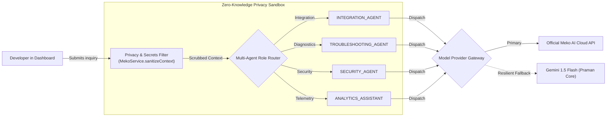

# Praman Network: Meko AI Multi-Agent Developer Assistant

## 1. Developer Experience Architecture

**Meko AI** serves as the developer intelligence layer embedded directly into the Praman SaaS Dashboard (`apps/web/src/app/dashboard/page.tsx`). It provides instant guidance on SDK integration, code debugging, security architecture, and analytics explanations.

---

## 2. Specialized Multi-Agent Roles

Instead of a generic chatbot, Meko AI operates through 4 domain-specialized personas:

### 1. `INTEGRATION_AGENT`
- **Scope:** Guides developers through installing `@praman-network/react` and `@praman-network/sdk`.
- **Outputs:** Context-aware TypeScript snippets featuring `PramanProvider`, `PramanLoginButton`, `usePraman`, and `redirectUri` handling in Next.js and Vite applications.

### 2. `TROUBLESHOOTING_AGENT`
- **Scope:** Rapid diagnostic analysis for integration errors.
- **Error Codes Handled:**
  - `DOMAIN_NOT_WHITELISTED`: Missing origin domain in dashboard.
  - `UNAUTHORIZED_REDIRECT_URI`: Mismatched OAuth callback URL.
  - `NONCE_MISMATCH`: Replayed or expired session challenge.
  - `ZK_VERIFICATION_FAILED`: Biometric distance exceeding threshold or invalid circuit witness.

### 3. `SECURITY_AGENT`
- **Scope:** Zero-knowledge cryptographic architecture and identity protection.
- **Topics:** Groth16 BN254 circuit constraints, Poseidon hash preimage resistance, DNS TXT domain ownership verification, and Solana Devnet attestation audit trails.

### 4. `ANALYTICS_ASSISTANT`
- **Scope:** Telemetry performance optimization.
- **Topics:** Verification volume spikes, p50 and p95 latency percentiles, and transaction confirmation times on Solana.

---

## 3. Strict Privacy & Zero-Raw Biometric Invariant

Praman enforces cryptographic boundaries to prevent confidential developer credentials or biometric data from ever reaching LLM endpoints:

1. **Automated Context Scrubbing (`MekoService.sanitizeContext`):**
   - Developer API Secrets (`prm_secret_...`) $\rightarrow$ `[REDACTED_API_SECRET]`
   - Webhook Secrets (`whsec_...`) $\rightarrow$ `[REDACTED_WEBHOOK_SECRET]`
   - Private Keys (RSA/ECC PEM blocks) $\rightarrow$ `[REDACTED_PRIVATE_KEY]`
   - Cryptographic hashes and 64-char hex strings $\rightarrow$ `[REDACTED_CRYPTO_HASH]`
2. **Zero-Biometrics Rule:** Raw facial images, floating-point embedding vectors, and Circom witness wires are **never passed** into the AI context under any circumstances.
3. **Advisory Role Only:** Meko AI operates as a read-only advisor. It cannot execute database writes, rotate production API keys, or override biometric verification policies.

---

## 4. Resilient Fallback Architecture

If `MEKO_ENABLED=false` or external network access is restricted:
- The system automatically engages the built-in `GeminiAssistantService` adapter.
- The developer experience remains continuous and fully functional with identical role specialization.

